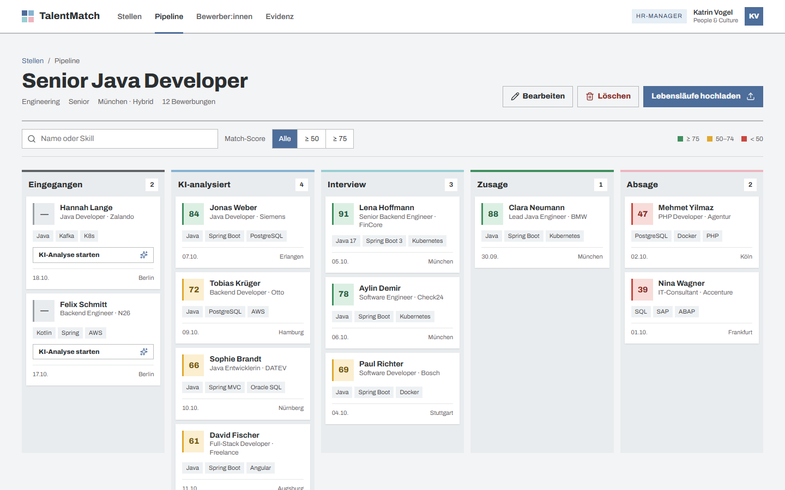
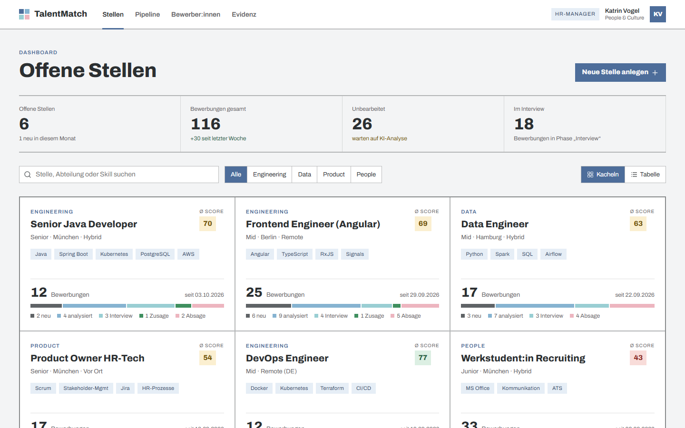
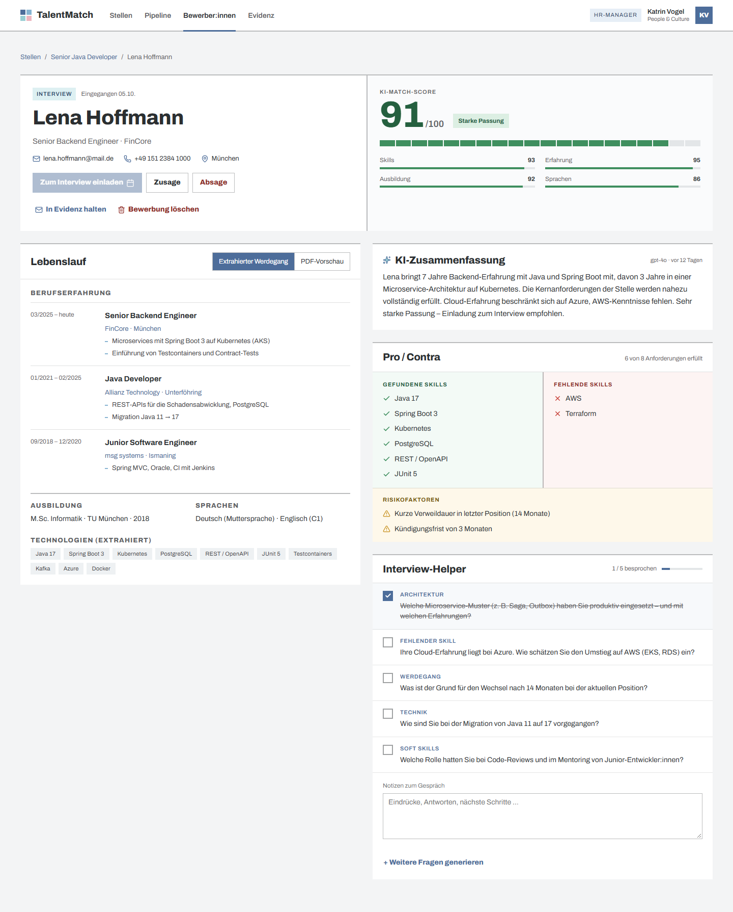
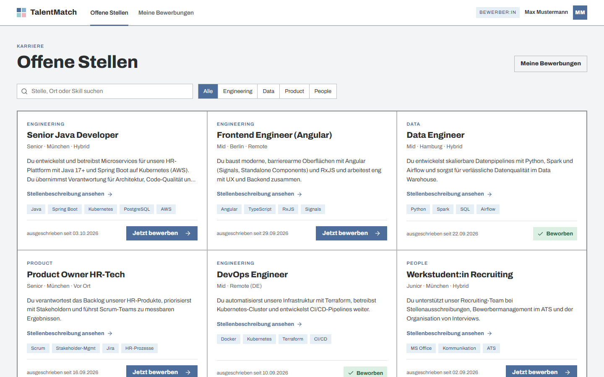
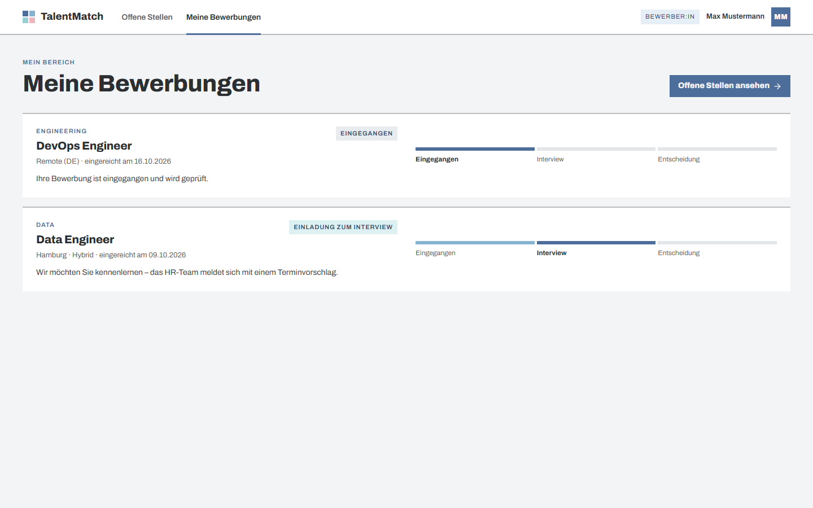

# TalentMatch

[](https://github.com/CarmenVavra/talentmatch-app/actions/workflows/ci.yml)
[](LICENSE)

**KI-gestütztes Recruiting:** TalentMatch liest Lebensläufe als PDF ein, gleicht sie per OpenAI mit der
Stelle ab und liefert HR einen Match-Score, eine Pro/Contra-Matrix und passende Interviewfragen.
Bewerber:innen bewerben sich über ein eigenes Portal und verfolgen dort den Status ihrer Bewerbung.



## Funktionen

**Für HR**

- **Stellen-Dashboard** mit Kennzahlen, Filter und Kachel-/Tabellenansicht; Stellen anlegen, bearbeiten
  und löschen (Beschreibung mit **Fett**-Markup)
- **Kanban-Pipeline** pro Stelle (Eingegangen → KI-analysiert → Interview → Zusage/Absage) mit Drag & Drop
- **Sammel-Upload** mehrerer PDFs: Die App erkennt Lebenslauf, Skill-Profil und Anschreiben und fasst
  Unterlagen derselben Person zusammen; Duplikate lassen sich zusammenführen
- **KI-Analyse** (Spring AI + GPT-4o): Match-Score aus Skills, Erfahrung, Ausbildung und Sprachen,
  Zusammenfassung, Risikofaktoren und Interview-Helper
- **Evidenz (Talentpool):** Absage mit Einwilligungsanfrage per E-Mail, Antwort ohne Login, automatische
  Erinnerung und Löschung nach Fristen
- **Postausgang** für alle E-Mails, optional Versand per SMTP

**Für Bewerber:innen**

- Registrierung, Login und Passwort ändern
- Offene Stellen mit Detailseite, Bewerbung mit Lebenslauf, Skill-Profil und Anschreiben
- Statusverfolgung unter „Meine Bewerbungen“ (bewusst ohne Score oder KI-Bewertung)

## Screenshots

| Stellen-Dashboard | KI-Analyse einer Bewerbung |
|---|---|
|  |  |

| Bewerber-Portal: offene Stellen | Bewerber-Portal: meine Bewerbungen |
|---|---|
|  |  |

## Technik

| Bereich | Umsetzung |
|---|---|
| Frontend | Angular 21 (Standalone Components, Signals, Zoneless), Reactive Forms, CDK Drag & Drop |
| Backend | Spring Boot 4, Java 21, Spring Security mit JWT, Spring Data JPA, Controller → Service → Repository |
| KI | Spring AI 2 mit OpenAI GPT-4o, Structured Output über `BeanOutputConverter` |
| PDF | Apache Tika zur Text-Extraktion, Original-PDF für die Vorschau |
| Datenbank | H2 lokal (ohne Installation), PostgreSQL per Profil bzw. Docker |
| Qualität | 130 Backend-Tests (JUnit 5, `@WebMvcTest`, `@SpringBootTest`), 168 Frontend-Tests, ESLint, Prettier, Checkstyle, GitHub Actions |

## Schnellstart

Voraussetzungen: JDK 21+ und Node.js 20+.

```bash
git clone https://github.com/CarmenVavra/talentmatch-app.git
cd talentmatch-app
```

**Windows:** `start.bat` startet Backend (Port 8080) und Frontend (Port 4200) und öffnet den Browser;
`stop.bat` beendet beides.

**Docker (alle Systeme):** `docker compose up --build` startet die App mit PostgreSQL unter
http://localhost:8081.

**Manuell** (zwei Terminals, danach http://localhost:4200):

```bash
cd backend && ./mvnw spring-boot:run
```

```bash
cd frontend && npm install && npm start
```

Beim ersten Start legt die App Demo-Stellen, über 100 Demo-Bewerbungen mit fertigen KI-Analysen und zwei
Demo-Konten an (HR-Manager:in und Bewerber:in). Die Zugangsdaten stehen in
[`application.yml`](backend/src/main/resources/application.yml) unter `talentmatch.seed`.

Für neue KI-Analysen wird ein OpenAI-Key benötigt (`OPENAI_API_KEY`); ohne Key funktioniert alles
außer der Analyse neu hochgeladener Lebensläufe.

## Dokumentation

Details zu Konfiguration, E-Mail-Versand, Evidenz-Fristen und Architektur stehen in [SETUP.md](SETUP.md).

## Lizenz

[MIT](LICENSE) © 2026 Carmen Gregor
